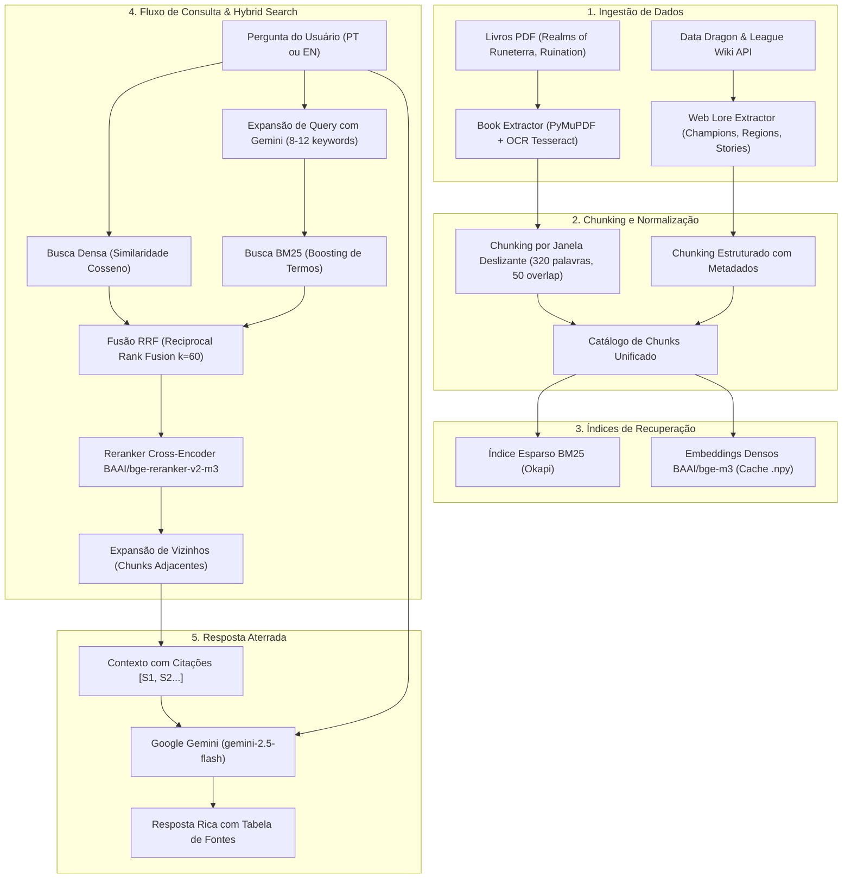

# 🏛️ Arquitetura do Sistema Runeterra Lore RAG

Este documento detalha o funcionamento arquitetural do sistema de RAG (Retrieval-Augmented Generation) para League of Legends, combinando fontes estáticas (livros em PDF) e fontes dinâmicas extraídas da Web.

---

## 📐 Visão Geral da Arquitetura

---

## 🧩 Componentes do Sistema

### 1. Ingestão Multimodal de Documentos
- **PDFs de Livros**: O `src/book_extractor.py` extrai texto nativo via `pypdf`. Páginas com pouco texto passam por OCR de alta fidelidade (200 DPI) via `fitz` (PyMuPDF) e `pytesseract`.
- **Web Lore**: O `src/lore_extractor.py` consome a API do Riot Data Dragon (champions, spells, quotes) e MediaWiki API (histórias, regiões, contos canônicos), salvando arquivos `.json` e `.md` em `data/web_lore/`.

### 2. Chunking com Preservação de Fronteiras
- Janela de **320 palavras** com **50 palavras de sobreposição** (~420 tokens de prosa).
- Transcende quebras de página para manter cenas e diálogos intactos.
- Rastreia metadados essenciais: `source_name`, `page_start`, `page_end`, `chapter`, `category`, `region`.

### 3. Recuperação Híbrida (Hybrid Retrieval)
- **BM25**: Recuperação lexical eficiente para nomes próprios exatos (ex: *Camavor*, *Sanctum*, *Viego*, *Isolde*, *Petricite*).
- **BGE-M3**: Modelo de embedding denso multilíngue de 1024 dimensões com normalização L2.
- **RRF (Reciprocal Rank Fusion)**: Combina rankings de forma robusta e invariante a escalas:
  $$\text{RRF\_Score}(d) = \sum_{r \in R} \frac{1}{k + \text{rank}_r(d)}$$
- **Reranker Cross-Encoder (`bge-reranker-v2-m3`)**: Avalia a relação entre pergunta e passagem completa com atenção cruzada total.

### 4. Expansão de Vizinhos (Neighbor Chunking)
- Para os melhores candidatos do reranking, o motor busca automaticamente o chunk anterior e posterior pertencentes ao mesmo documento/livro, costurando o texto e eliminando palavras duplicadas da sobreposição.

### 5. Geração e Citação
- O LLM recebe regras rígidas de ancoragem (grounding): nunca inventar informações e responder estritamente baseado no contexto.
- Retorna tabela estruturada com Fonte, Páginas e Capítulos utilizados.
